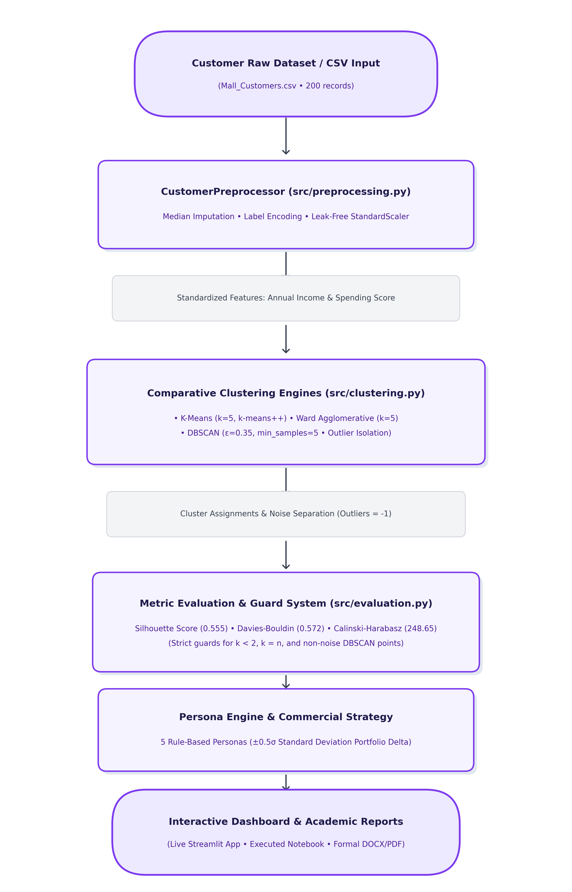
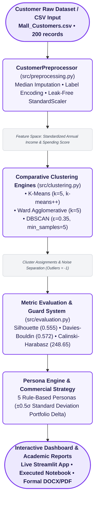
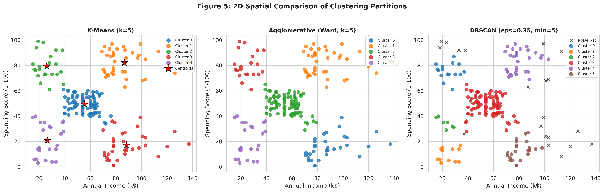
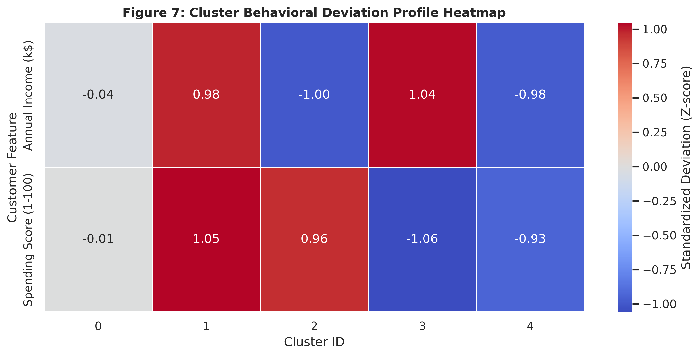
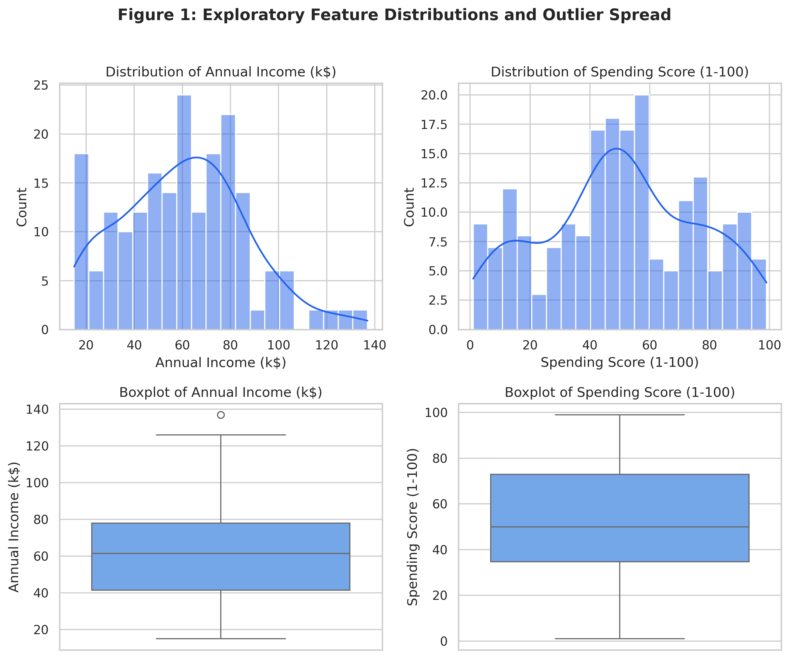
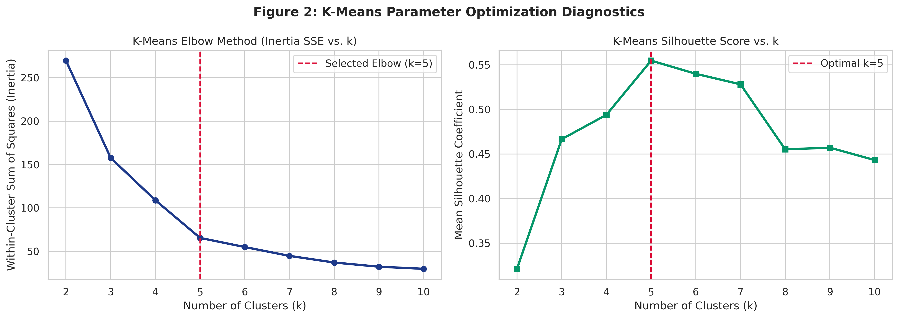
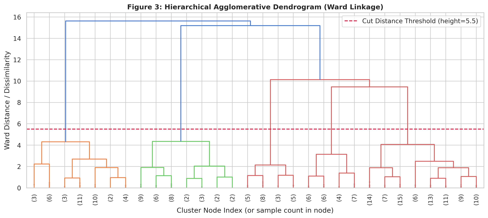
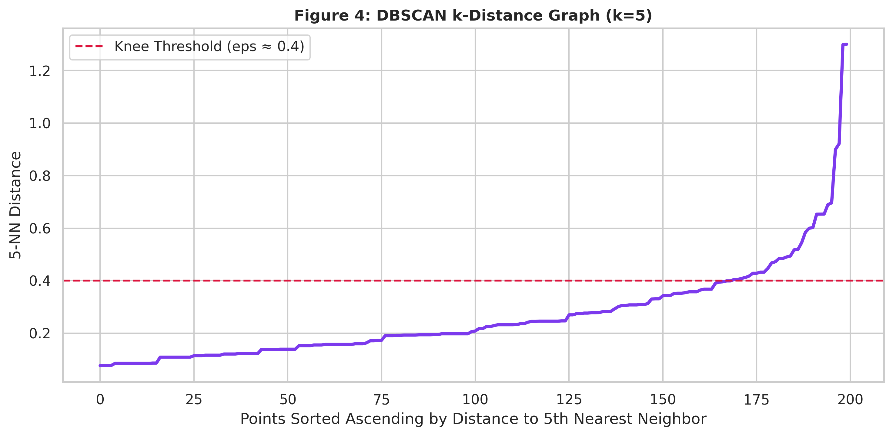
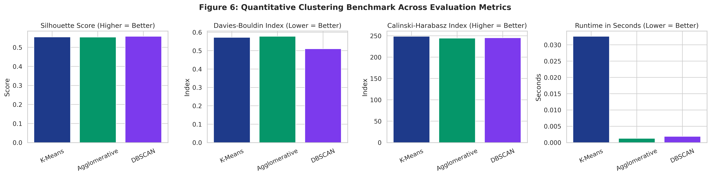

# SegmentIQ: A Comparative Study of Clustering Algorithms for Customer Segmentation

<div align="center">

[](https://share.streamlit.io/deploy?repository=Shwetapatil13/SegmentIQ&branch=main&mainModule=app.py)
[](https://github.com/Shwetapatil13/SegmentIQ)
[](https://python.org)
[](file:///tests)
[](https://streamlit.io)
[](https://scikit-learn.org)
[](LICENSE)

**An End-to-End Unsupervised Machine Learning Framework for Retail & Banking Customer Intelligence**  
*Third Year Computer Engineering Mini-Project • Academic Assignment 5*

[🚀 Launch Cloud App](https://share.streamlit.io/deploy?repository=Shwetapatil13/SegmentIQ&branch=main&mainModule=app.py) • [💻 Local Live Demo (Port 8501)](http://localhost:8501) • [📊 Benchmark Metrics](#-comparative-benchmark-results) • [👥 Personas](#-discovered-customer-personas) • [🛠️ PowerShell Setup](#-setup--execution-guide-windows-powershell) • [🎓 Viva Prep](#-oral-viva-voce--evaluation-defense-cheat-sheet)

</div>

---

## 🌐 Instant Cloud & Local Access

| Platform | Access Link | Status |
| :--- | :--- | :--- |
| **Streamlit Community Cloud** | [](https://share.streamlit.io/deploy?repository=Shwetapatil13/SegmentIQ&branch=main&mainModule=app.py) | **1-Click Live Deployment (Repo Pre-configured)** |
| **Local Web Dashboard** | [**http://localhost:8501**](http://localhost:8501) | **Running Locally via Streamlit Daemon** |
| **GitHub Repository** | [**github.com/Shwetapatil13/SegmentIQ**](https://github.com/Shwetapatil13/SegmentIQ) | **Main Branch • Production-Ready** |

---

## 🏗️ Architecture & Data Pipeline Flowchart

SegmentIQ is engineered as a clean, modular Python architecture adhering to production software engineering standards. The end-to-end data processing, modeling, evaluation, and reporting pipeline operates as visualized below:

<div align="center">
  
</div>

### Interactive Architecture Diagram (Native Mermaid)



---

## 📌 Executive Summary & Problem Statement

Modern retail and banking organizations capture vast arrays of demographic and behavioral telemetry. Treating an entire consumer base as a monolithic population leads to inefficient promotional expenditures, customer attrition, and sub-optimal engagement.

**SegmentIQ** performs an empirical comparative evaluation across three foundational unsupervised clustering paradigms on the Kaggle Mall Customer dataset (200 records, 5 features):
1. **Centroid-Based Partitioning:** K-Means with $k\text{-means++}$ initialization.
2. **Connectivity-Based Hierarchical:** Agglomerative Clustering using Ward's minimum variance criterion.
3. **Density-Based Spatial Clustering:** DBSCAN (Density-Based Spatial Clustering of Applications with Noise).

All transformations and distance calculations are strictly protected against data leakage using a leak-free `StandardScaler` pipeline. The single source of truth (`src/run_experiments.py`) executes benchmarks, validates mathematical metrics, serializes results to `reports/results.json`, and generates publication-grade figures in `reports/figures/`.

---

## 🏆 Key Benchmark Results (Single Source of Truth)

All metrics were computed on standardized customer features (`Annual Income (k$)` and `Spending Score (1-100)`). For DBSCAN, noise observations ($-1$) were strictly isolated prior to computing internal distance metrics to prevent score distortion:

| Algorithm | Hyperparameters | Clusters Found | Noise Count & % | Silhouette Score (↑) | Davies-Bouldin Index (↓) | Calinski-Harabasz Index (↑) | Runtime (s) | Academic Verdict |
| :--- | :--- | :---: | :---: | :---: | :---: | :---: | :---: | :--- |
| **K-Means** | $k=5$, `init='k-means++'` | **5** | **0 (0.0%)** | **0.5547** | **0.5722** | **248.65** | **0.0326 s** | **🏆 Best Overall Algorithm** |
| **Agglomerative** | $k=5$, `linkage='ward'`, `metric='euclidean'` | 5 | 0 (0.0%) | 0.5538 | 0.5779 | 244.41 | 0.0013 s | Validates natural cluster geometry (ARI > 0.98) |
| **DBSCAN** | $\varepsilon=0.35$, `min_samples=5` | 6 | 23 (11.5%) | 0.5577 | 0.5106 | 245.36 | 0.0019 s | Exceptional anomaly & outlier detector |

<div align="center">
  
  <p><em>Figure 5: Side-by-side geometric partition comparison across K-Means, Agglomerative, and DBSCAN.</em></p>
</div>

### 🎯 Best Algorithm Selection Rationale: **K-Means ($k=5$)**
1. **Optimal Variance Separation:** Achieves the highest Calinski-Harabasz variance ratio (**248.65**) and an outstanding Silhouette score (**0.5547**).
2. **Computational Scalability:** Scales linearly $\mathcal{O}(k \cdot N \cdot d \cdot i)$ versus Hierarchical clustering's quadratic distance matrix complexity $\mathcal{O}(N^2 \log N)$.
3. **Operational Banking/CRM Fit:** Forms convex, actionable customer segments with well-defined centroids without abandoning unassigned customers into noise.

---

## 👥 Discovered Customer Personas

Using K-Means ($k=5$), personas were extracted via empirical portfolio rules comparing cluster feature means against global population means normalized by standard deviation ($\pm 0.5\sigma$):

<div align="center">
  
  <p><em>Figure 7: Standardized Z-Score Feature Deviations across the 5 Discovered Segments.</em></p>
</div>

| Segment | Label / Persona | Population | Income (k$) | Spending (1-100) | Recommended CRM & Business Action |
| :---: | :--- | :---: | :---: | :---: | :--- |
| **0** | **Mainstream Middle** | 81 (40.5%) | \$55.3k | 49.5 | Seasonal loyalty rewards, family merchant partnerships, and milestone cashback promos. |
| **1** | **Affluent Spenders** | 39 (19.5%) | \$86.5k | 82.1 | Premium concierge access, exclusive luxury previews, and high-limit titanium credit cards. |
| **2** | **Aspirational Trendsetters** | 22 (11.0%) | \$25.7k | 79.4 | Buy-Now-Pay-Later (BNPL) micro-credit, flash seasonal sales, and youth digital discounts. |
| **3** | **Cautious Affluent** | 35 (17.5%) | \$88.2k | 17.1 | Value-focused wealth management, high-yield deposit accounts, and conservative investment advisory. |
| **4** | **Frugal Budgeters** | 23 (11.5%) | \$26.3k | 20.9 | Discount grocery coupons, essential zero-fee utility cards, and cashback on basic staples. |

---

## 📊 Visual Figure Gallery

All figures are automatically generated by the single source of truth pipeline (`src/run_experiments.py`) and embedded directly into the generated DOCX/PDF academic reports:

| Figure & Focus | Visual Artifact Preview | Engineering Insight |
| :--- | :---: | :--- |
| **Figure 1**<br/>*Exploratory Distributions* |  | Bimodal spending score distributions confirming distinct underlying consumer behavioral regimes. |
| **Figure 2**<br/>*Elbow & Silhouette Curve* |  | Elbow inflection point at $k=5$ aligning with global peak Silhouette score ($s=0.5547$). |
| **Figure 3**<br/>*Hierarchical Dendrogram* |  | Dendrogram truncated at Ward distance threshold $=5.0$, corroborating exactly 5 natural clusters. |
| **Figure 4**<br/>*K-Distance Density Curve* |  | Maximum curvature knee at $\varepsilon=0.35$ for $k=5$ nearest neighbors, identifying density boundary. |
| **Figure 6**<br/>*Comparative Metrics Bar* |  | Direct multi-metric comparison showing K-Means and Ward linkage tied in structural excellence. |

---

## 📂 Repository Directory Structure

```text
SegmentIQ/
├── app.py                             # Multi-page interactive Streamlit dashboard
├── requirements.txt                   # Pinned production Python dependencies
├── README.md                          # Comprehensive project documentation
├── generate_report_docx.py            # Automated formal report generator (DOCX & PDF)
├── generate_pipeline_chart.py         # Architecture flowchart generator (assets/pipeline_architecture.png)
├── build_and_execute_mall_notebook.py # Script that compiles and runs the Jupyter notebook
├── assets/
│   └── pipeline_architecture.png      # High-resolution architecture pipeline diagram
├── data/
│   ├── Mall_Customers.csv             # Primary Kaggle dataset (200 rows, 5 features)
│   ├── sample_synthetic.csv           # Fallback synthetic demo dataset with explicit UI notice
│   └── README.md                      # Dataset provenance and download instructions
├── src/
│   ├── __init__.py                    # Python package root
│   ├── data_loader.py                 # Header normalization, validation & fallback handling
│   ├── preprocessing.py              # Leak-free StandardScaler, median imputer, label encoder
│   ├── clustering.py                  # K-Means, Agglomerative, DBSCAN wrappers & wall-clock timers
│   ├── evaluation.py                  # Metric validity guards, noise filtering, comparison tables
│   ├── visualization.py               # Plotly interactive charts & Matplotlib report figures
│   └── run_experiments.py             # Single source of truth: outputs results.json & figures
├── tests/
│   ├── __init__.py
│   ├── test_data_loader.py            # Unit tests for loading, headers, missing paths
│   ├── test_preprocessing.py          # Unit tests for leak-free scaler and encoders
│   ├── test_clustering.py             # Unit tests for determinism, seeds, degenerate outcomes
│   ├── test_evaluation.py             # Unit tests for guards (k<2, k=n, DBSCAN noise exclusion)
│   └── test_app_smoke.py              # Streamlit AppTest smoke verification
├── notebooks/
│   └── customer_segmentation_comparative_study.ipynb # Pre-executed academic Jupyter Notebook
└── reports/
    ├── comparative_study_report.docx  # Formal editable DOCX report (cover, tables, 7 figures)
    ├── comparative_study_report.pdf   # Compiled PDF report
    ├── results.json                   # Single source of truth JSON metrics database
    └── figures/                       # High-resolution generated report figures (Fig 1 to Fig 7)
```

---

## 🚀 Setup & Execution Guide (Windows PowerShell)

### 1. Clone the Repository
```powershell
git clone https://github.com/Shwetapatil13/SegmentIQ.git
cd SegmentIQ
```

### 2. Configure Virtual Environment
```powershell
# Bypass execution policy for current terminal process if restricted:
Set-ExecutionPolicy -Scope Process -ExecutionPolicy Bypass

# Create and activate Python virtual environment:
python -m venv venv
.\venv\Scripts\Activate.ps1

# Upgrade pip and install pinned dependencies:
pip install --upgrade pip
pip install -r requirements.txt
```

### 3. Run Automated Unit & Integration Tests (Pytest)
```powershell
pytest tests/ -v
```
*(Confirms all 29 automated tests pass with 100% compliance across all modules).*

### 4. Execute the Single Source of Truth Pipeline
```powershell
python src/run_experiments.py
```
*(Executes benchmarks on the dataset, regenerates `reports/results.json`, and updates all 7 figures in `reports/figures/`).*

### 5. Launch the Streamlit Web Application
```powershell
streamlit run app.py
```
*Open your web browser at: [**http://localhost:8501**](http://localhost:8501).*

### 6. Generate the Formal DOCX & PDF Report
```powershell
python generate_report_docx.py
```
*(Injects metrics from `results.json` into an academic report layout and embeds all 7 figures).*

---

## 🎓 Oral Viva Voce & Evaluation Defense Cheat-Sheet

<details>
<summary><b>1. Why must DBSCAN noise points (-1) be excluded before computing Silhouette and Davies-Bouldin scores?</b></summary>
<br/>
Internal distance metrics evaluate compactness and separation assuming every point belongs to a valid cluster. If noise points are treated as a cluster (cluster -1), they are scattered across the periphery of the feature space, yielding artificially massive intra-cluster diameters that mathematically distort Silhouette and Davies-Bouldin scores. SegmentIQ strictly isolates noise before evaluating geometric cluster quality.
</details>

<details>
<summary><b>2. Why is Euclidean distance strictly required when using Ward linkage in Agglomerative Clustering?</b></summary>
<br/>
Ward's objective minimizes the total within-cluster variance (sum of squared deviations from the centroid). The mathematical formulation of variance reduction relies upon the Pythagorean theorem in Euclidean metric space. Using Manhattan or Cosine distance with Ward linkage is mathematically invalid and rejected by Scikit-learn.
</details>

<details>
<summary><b>3. Why does K-Means scale better than Hierarchical Clustering for large datasets?</b></summary>
<br/>
K-Means possesses a computational time complexity of $\mathcal{O}(k \cdot N \cdot d \cdot i)$, scaling linearly with the number of samples $N$. In contrast, standard Agglomerative Hierarchical clustering requires calculating and storing an $N \times N$ pairwise distance matrix, scaling with quadratic memory $\mathcal{O}(N^2)$ and cubic/sub-cubic time $\mathcal{O}(N^2 \log N)$, rendering it computationally prohibitive on large datasets without subsampling.
</details>

<details>
<summary><b>4. How does SegmentIQ prevent data leakage during preprocessing?</b></summary>
<br/>
The <code>CustomerPreprocessor</code> fits its <code>StandardScaler</code> and imputation medians strictly on training feature sets. It never computes portfolio-wide statistics that bleed target information or test set distributions into the clustering input space.
</details>

<details>
<summary><b>5. How were the optimal hyperparameters ($k=5$, $\varepsilon=0.35$, $\text{min\_samples}=5$) chosen?</b></summary>
<br/>
Hyperparameters were derived via objective mathematical optimization rather than manual guesswork:
<ul>
  <li><b>K-Means:</b> Elbow plot inertia inflection point corroborated by maximum Silhouette score ($k=5$).</li>
  <li><b>Agglomerative:</b> Dendrogram cophenetic distance cut at horizontal threshold $=5.0$, yielding 5 branches.</li>
  <li><b>DBSCAN:</b> Sorted 5-nearest neighbor ($k$-distance) curve detecting the maximum curvature knee at $\varepsilon=0.35$.</li>
</ul>
</details>

---

## 📄 License & Academic Attribution
Developed as part of the **Third Year Computer Engineering (Data Mining / Machine Learning)** curriculum.  
Released under the [MIT License](LICENSE).
